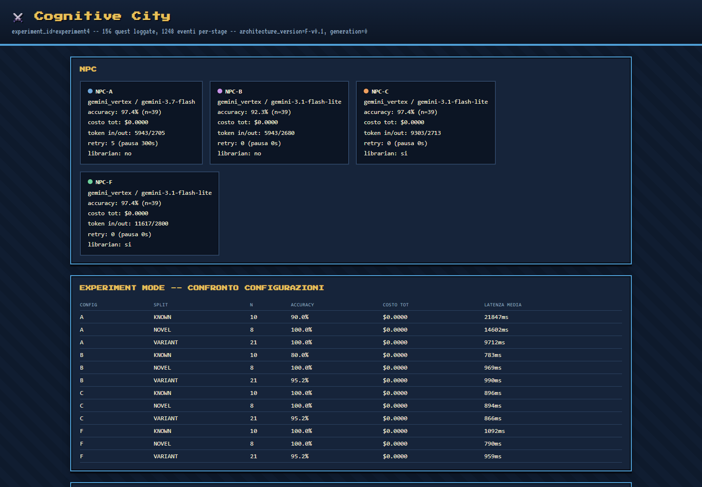

<p align="center">🧠</p>

<h1 align="center">Procedural Memory Lab</h1>

<p align="center">Un caso di studio sperimentale: una memoria procedurale aiuta i modelli linguistici più piccoli a risolvere problemi nuovi, oppure recupera soltanto risposte già viste?</p>

<p align="center"><a href="README.md">English</a> · <b>Italiano</b></p>



## La domanda

Un modello linguistico più economico può avvicinarsi a uno più grande su un compito concreto se può recuperare procedure scritte durante tentativi precedenti?

Un miglioramento dopo il recupero di informazioni non dimostra, da solo, che il modello abbia riutilizzato un metodo generale: potrebbe aver semplicemente rivisto una soluzione simile. Questo progetto mette a confronto le due ipotesi, anziché trattare ogni aumento di accuratezza come apprendimento.

Il banco di prova è composto da funzioni Python con bug reali e verifiche deterministiche. Ogni problema è affrontato in quattro condizioni:

| Condizione | Risolutore | Contesto aggiuntivo |
|---|---|---|
| A — Expert | modello più grande | nessuno |
| B — Small | modello più piccolo | nessuno; baseline |
| F — Skill Library | modello più piccolo | procedura generale recuperata |
| C — Solution Bank | modello più piccolo | soluzione corretta di un caso simile |

Il confronto F–B misura se il recupero aiuta; F–C mette alla prova l'ipotesi più importante: il modello ha riutilizzato una procedura oppure gli è bastato un esempio già risolto?

## Risultati e limiti

Nei primi cinque run completi, Skill Library ha superato la baseline del modello piccolo in tutti e cinque. Sui 116 tentativi aggregati, il miglioramento osservato è di 7,8 punti percentuali. È un risultato incoraggiante, non conclusivo: i run non sono repliche indipendenti pulite, la libreria è cambiata nel tempo e il beneficio varia tra i diversi meccanismi.

Anche i risultati scomodi restano visibili. Nel run iniziale più ampio, solo due dei dieci pattern coperti risultavano positivi secondo la classificazione economica/accuratezza del progetto. Un miglioramento complessivo non basta a giustificare ogni singolo elemento della libreria.

## Una verifica causale

Una skill sui confronti in virgola mobile sembrava suggerire una tolleranza, ma poteva limitarsi a ripetere un valore costante. Modificando quel valore nella procedura recuperata, la risposta è cambiata di conseguenza in 12 casi su 12; modificando una costante non pertinente, non è cambiata in 6 casi su 6.

Il modello selezionava la regola corretta, ma ne ripeteva un valore anziché derivarlo. Dopo aver riscritto la procedura in modo da richiedere il calcolo, ha iniziato a ricavare tolleranze su sette ordini di grandezza. La lezione è circoscritta ai test svolti: formulare esplicitamente il passaggio di derivazione può contare quanto la capacità del modello.


## Com'è costruito

- `domain/` definisce i problemi, le famiglie di bug e le verifiche deterministiche.
- `agents/` prepara i prompt e coordina i risolutori.
- `librarian/` recupera, confronta e gestisce le procedure.
- `experiment/` esegue condizioni abbinate, salva gli eventi e produce i riepiloghi.
- `verification/` contiene probe causali, holdout e verifiche di coerenza.
- `city/` genera le visualizzazioni HTML dei risultati.

Il vocabolario RPG (Quest, Book, Librarian) è una metafora di navigazione per concetti ordinari come recupero di informazioni e memoria procedurale.

## Avvio

È richiesto Python 3.11 o successivo. Installare le dipendenze elencate nella cartella superiore del workspace, poi avviare i comandi da quella stessa cartella per rendere importabile il pacchetto `cognitive_rpg`:

```sh
python -m pip install -r requirements.txt
python -m cognitive_rpg.settings_wizard
python -m cognitive_rpg.experiment.experiment_0
```

Gli adapter mock consentono lo sviluppo senza chiamate a pagamento. Gli esperimenti reali richiedono le credenziali del provider, configurate localmente: i segreti non vanno salvati in questa repository.

## Stato del progetto

È un progetto di ricerca indipendente in corso, non un articolo sottoposto a revisione tra pari né un framework pronto per la produzione. I risultati vanno letti come evidenza di un caso di studio, insieme ai relativi limiti.

## Licenza

Copyright © 2026 Ferdinando Gregorio Fernandez. Tutti i diritti riservati. Il codice è visibile per la valutazione del portfolio e della ricerca; riuso, ridistribuzione e opere derivate non sono autorizzati. Per i dettagli, consultare [LICENSE](LICENSE).
