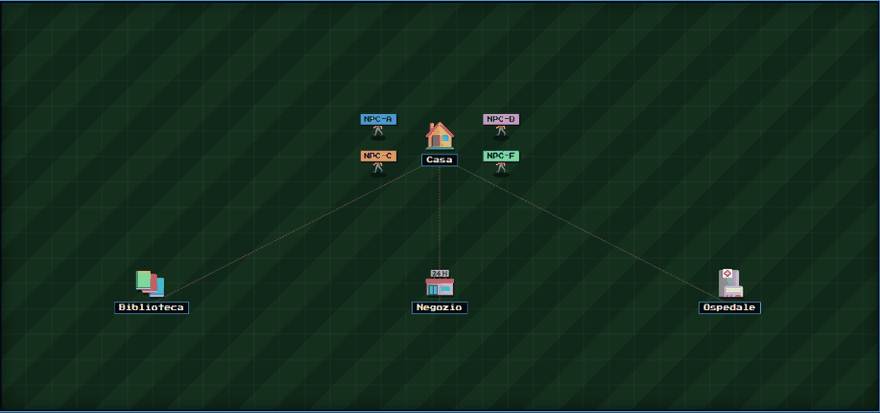
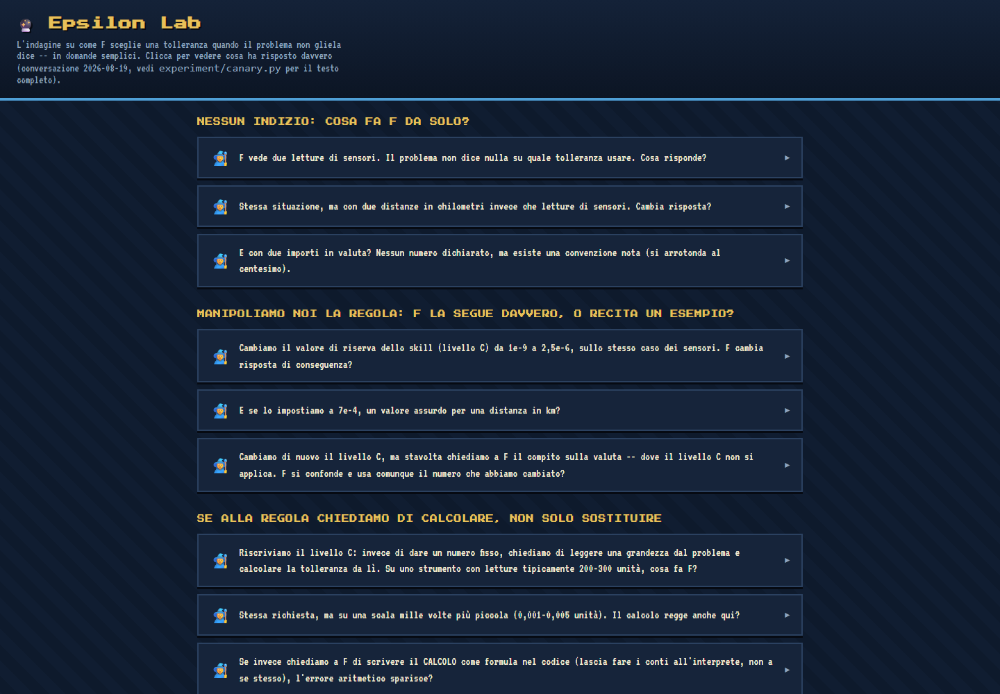

<h1 align="center">Procedural Memory Lab</h1>

<p align="center">Un modello linguistico piccolo migliora recuperando una procedura, o gli basta rivedere una risposta simile?</p>

<p align="center"><a href="README.md">English</a> · <b>Italiano</b></p>

<p align="center"></p>

<p align="center"><sub>Una quest rigiocata in Cognitive City, la pagina che trasforma un run concluso in una piccola città. I quattro agenti (NPC-A, B, C ed F) ricevono lo stesso bug a <i>Casa</i>. C ed F passano prima dalla <i>Biblioteca</i> per consultare qualcosa (<i>Sto imparando!</i>). Poi tutti scrivono una soluzione al <i>Negozio</i> e fanno i test all'<i>Ospedale</i>, prima di tornare a casa con <i>Missione riuscita</i>.</sub></p>

## La domanda

Un modello economico può avvicinarsi a uno costoso e potente su un compito reale, se può leggere conoscenza scritta in precedenza? E soprattutto: quella conoscenza deve essere una procedura generale, o basta avergli già mostrato una soluzione simile?

La seconda domanda è quella difficile. Un sistema che sembra imparare potrebbe soltanto recuperare risposte già viste. Copia e non generalizza, e le due cose non si distinguono contando quanti problemi risolve. La differenza va isolata di proposito, con un esperimento pensato per renderla visibile.

Il vocabolario del codice (Quest, Book, NPC, Librarian) è preso in prestito da un gioco di ruolo. È solo un'etichetta comoda per idee standard: recupero, memoria procedurale e instradamento tra modelli.

## Il banco di prova: un bug, quattro modi di affrontarlo

Ogni compito, una quest, è una funzione Python con un bug reale. Il verdetto non è mai un'opinione. Eseguo `pytest` in un sottoprocesso separato, così un modello linguistico non giudica mai un altro modello linguistico e il verificatore non può coincidere con ciò che viene verificato.

Lo stesso bug va a quattro agenti con lo stesso identico prompt di base.

| Config | Chi risolve | Cosa riceve in più | Cosa dovrebbe mostrare |
|---|---|---|---|
| **A, Expert** | modello grande e costoso | niente | quanto costerebbe farlo bene ogni volta |
| **B, Small** | modello economico | niente | quanto vale il modello nudo, la vera base di confronto |
| **F, Small + Skill Library** | modello economico | una procedura scritta dopo un tentativo precedente: generale, non legata a un caso | se una procedura riusabile aiuta |
| **C, Small + Solution Bank** | modello economico | la soluzione corretta di un problema simile già visto: un esempio, non una regola | se basta aver già visto un caso simile |

C è il pezzo che manca in gran parte dei discorsi sulle librerie di skill. Se F batte B è facile dire che la libreria insegna qualcosa di generale. Ma se anche C batte B di una quantità simile, quel guadagno potrebbe non c'entrare con una procedura: basterebbe aver visto un caso simile. Confrontare F con C, e non solo con B, è l'unico modo per distinguere le due storie.

Un dettaglio onesto. La soluzione data a C è la funzione di riferimento del catalogo dei bug, non una vera trascrizione scritta da Expert. È un sostituto ragionevole, perché Expert di solito risolve dal 95 al 100 per cento dei casi, ma non è la stessa cosa e lo dichiaro qui.

## Come si giudica un run

Ogni bug appartiene a uno split:

- **KNOWN** è l'esempio canonico di un pattern di bug già coperto da una skill o da una soluzione.
- **VARIANT** è lo stesso pattern con un problema diverso, e verifica la generalizzazione.
- **NOVEL** è un pattern mai coperto, di proposito. Per tre pattern non scrivo mai né una skill né una soluzione, così esiste sempre un gruppo di controllo permanente.

Ogni recupero, per F e per C, registra anche la sua copertura: `NONE` se non è stato trovato nulla di pertinente, `FULL` per una corrispondenza esatta, `PARTIAL` per C quando la soluzione riguarda un problema diverso della stessa famiglia.

Tengo separate le due cose perché rispondono a domande diverse. Se F senza nulla di trovato si comporta come B, ma F con una corrispondenza esatta fa meglio, allora è il contenuto recuperato a spostare il risultato e non la semplice presenza di un meccanismo di recupero. Ne escono due numeri:

- **Delta Retrieval** è l'accuratezza con copertura `FULL` meno quella con `NONE`, dentro la stessa config. Dice quanto conta trovare qualcosa.
- **Delta Architecture** è l'accuratezza della config con copertura `FULL` meno quella di B. Dice quanto l'intera architettura supera il modello nudo quando il recupero funziona davvero.

Per ogni tentativo conservo anche costo, latenza, uso di token e verdetto di `pytest`, e i report si costruiscono da questi dati e non a memoria.

## Recitazione o derivazione: il controllo causale

Il risultato più interessante finora non è un numero di accuratezza. È un modo di non farsi ingannare da una correlazione.

Studiando la skill `floating_point_equality`, che insegna a scegliere una tolleranza (un epsilon) invece di confrontare numeri decimali per uguaglianza esatta, mi è venuto un sospetto. Su un compito senza indizi numerici, F rispondeva sempre `1e-9`. O il modello ragionava sulla scala del problema, oppure ripeteva meccanicamente una costante scritta nella skill. Guardare la correlazione non basta a distinguere le due ipotesi, quindi ho fatto un test causale: ho cambiato direttamente la costante nella skill (`1e-9`, poi `2.5e-6`, poi `7e-4`) e ho controllato se la risposta si muoveva con essa.

- È successo 12 volte su 12, su due compiti scollegati.
- Cambiare invece una costante di una sezione diversa della skill, quella sulla valuta, non ha avuto alcun effetto, 6 volte su 6, e nemmeno il cambiamento inverso.

Quindi il modello sceglieva la regola giusta e poi copiava un numero preso da essa. Non derivava l'epsilon dalla scala del problema. È una sostituzione letterale di uno slot preciso, non una vaga abitudine di citare esempi.

Avrebbe potuto chiudersi lì, ma ho riscritto la skill chiedendo una derivazione invece di una costante fissa, e il modello ha iniziato a derivare. Ha seguito la grandezza del problema su sette ordini di grandezza, con un solo piccolo errore aritmetico. Il collo di bottiglia non era una capacità mancante del modello. Era il contenuto dell'istruzione.

Una conferma pulita è arrivata su un dominio davvero diverso, le cifre significative in un confronto decimale. Lì il modello ha prodotto due epsilon diversi nello stesso test, ciascuno corretto per la propria struttura decimale. Una sostituzione meccanica non può produrre due numeri diversi entrambi corretti, solo una vera derivazione può.

Il test sta in `experiment/canary.py`. Usa compiti sintetici che né l'ottimizzatore né il generatore di skill hanno mai visto, perché altrimenti la skill verrebbe scritta per superare il test, cioè l'opposto di misurarlo. Una versione leggibile delle risposte del modello, trascritte a mano e non rigenerate, è stata conservata come piccola pagina.

<p align="center"></p>

## Cosa mostrano i cinque run completi

| Run | n | A (Expert) | B (Small) | F (Skill Library) | C (Solution Bank) | F contro B |
|---|---|---|---|---|---|---|
| 1 | 26 | 100,0% | 88,5% | 96,2% | 92,3% | +7,7 |
| 2 | 21 | 95,2% | 95,2% | 100,0% | non eseguita | +4,8 |
| 3 | 26 | 96,2% | 84,6% | 96,2% | 96,2% | +11,5 |
| 4 | 4 | 50,0% | 50,0% | 75,0% | 50,0% | +25,0 |
| 5 | 39 | 97,4% | 92,3% | 97,4% | 97,4% | +5,1 |

F ha battuto B in tutti e cinque i run completi, mai alla pari e mai peggio: 7,8 punti percentuali su 116 tentativi in totale. Il run 4 ha solo quattro compiti, quindi il suo +25 è per lo più rumore. Il primissimo run fatto su questo progetto, più piccolo e più vecchio di tutti questi, non mostrava alcun beneficio. È rimasto per un po' come unica conclusione scritta anche dopo che i run successivi lo avevano smentito, non perché lo nascondessi ma perché nessuno l'aveva ricontrollata. Non l'ho cancellato dalla storia. Semplicemente non è più la conclusione giusta.

Due limiti veri, non nascosti sotto la tabella.

**Non sono repliche indipendenti pulite.** I run condividono in gran parte lo stesso catalogo di compiti e, tra un run e l'altro, l'ottimizzatore ha compresso e riverificato le skill esistenti. Parte del vantaggio di F potrebbe riflettere una libreria che si affina su questi compiti specifici e non una generalizzazione a compiti mai visti.

**Il guadagno non è uniforme, meccanismo per meccanismo.** Nel run più completo (l'ultimo, n=39) il Delta Retrieval di F è negativo, meno 3,2 punti, mentre quello di C è a zero e mai negativo. Il meccanismo di recupero non aiuta nello stesso modo in ogni config, anche quando l'accuratezza finale coincide.

Sul costo, F paga in media tra 116 e 343 token di input in più rispetto a B per usare una skill già pronta. È il costo del recupero, e cambia da un run all'altro a seconda di quali skill vengono recuperate. Costruire una skill nuova, cioè l'ottimizzatore che la comprime e la riverifica, costa circa 1000-2000 token una tantum per pattern. Ogni report di run calcola un breakeven per pattern, cioè dopo quanti usi il costo di costruzione si ripaga rispetto a chiamare sempre Expert. Classifica inoltre i pattern in tre modi: `ECONOMICALLY_POSITIVE` se conviene sui token, `ACCURACY_POSITIVE` se non conviene sui token ma ha risolto qualcosa che A o B non risolvevano, `NEGATIVE` negli altri casi. Negativo non significa buttare la skill, perché con numeri così piccoli può avere un valore che le due metriche non catturano. Nel run più completo, su 10 pattern coperti uno è economicamente positivo e uno è positivo sull'accuratezza. Gli altri otto sono negativi. È un dato scomodo, ed è più onesto mostrarlo che nasconderlo.

I log completi dei run non fanno parte di questo repository pubblico, quindi questi numeri sono una mia lettura di quei log.

## Dall'esperimento controllato all'uso reale

Le stesse idee sono state poi portate a mano in Aria, un'app di studio che ho costruito per un utente reale con ADHD. Non è un prodotto in vendita. È il secondo terreno di prova della stessa domanda, con dati di comportamento reali invece di compiti sintetici. I due progetti restano separati di proposito, e tra loro non si condivide nulla a livello di codice.

Passare da un contesto sintetico a una persona vera ha cambiato alcune scelte.

- Le skill non vengono più generate in automatico dalle conversazioni. Una skill esiste solo quando qualcuno la crea di proposito.
- Il testo scritto dall'utente non viene mai riscritto in silenzio. L'unico accorciamento ammesso si può annullare, e viene tenuto solo se un secondo controllo indipendente conferma che obiettivo e criterio di riuscita restano intatti.
- Non ogni istruzione è una procedura. Solo un metodo, con un risultato atteso e un criterio di riuscita, può essere giudicato giusto o sbagliato da un esito. Una preferenza o una regola vincolante non è giusta o sbagliata in quel senso.

L'uso reale cambia anche il modo di misurare. Nell'esperimento posso forzare metà dei casi su F e metà su B. Nell'app è il sistema a decidere da solo quando una skill è pertinente, e questo introduce un bias nel campione, quindi le prove sono di due livelli di forza. Confrontare gruppi sull'uso ordinario è debole per costruzione, perché le richieste che attivano una skill tendono a essere più facili delle altre. La versione forte è un confronto appaiato alla cieca: la stessa richiesta reale risposta due volte, una con le skill e una senza, e giudicata senza sapere quale sia quale.

Cosa è emerso finora, con i suoi limiti.

- Il controllo causale descritto sopra è stato riusato su otto meccanismi di autoverifica che controllano l'output del modello indipendentemente da ciò che il modello ne dice. Ognuno è stato validato su un caso noto più una manipolazione diretta prima di entrare in uso. Restano tutti candidati: verificati una volta, ma non ancora osservati abbastanza a lungo nell'uso reale.
- Su un modello Gemma locale ho confrontato un meccanismo di recupero del comportamento con il solo prompt nudo su 22 coppie confrontabili, giudicate dagli stessi validator usati in produzione. Il risultato è stato 17 su 22 (77%) contro 13 su 22 (59%). Quasi tutto il vantaggio sta in un dominio, l'onestà sui materiali (6 su 9 contro 2 su 9). Sulla scomposizione dei compiti e sulle spiegazioni per principianti i due approcci sono più o meno pari. È un solo run per cella, senza ripetizioni, quindi la direzione è coerente con questo progetto ma il numero esatto non è conclusivo.
- Un risultato di qui è diventato una regola di prodotto. Quando si scrive una skill, vanno nominati esplicitamente i casi scomodi invece di fidarsi che il modello generalizzi da un principio. È la lezione del controllo sulla tolleranza.

Ho fermato di proposito anche una cosa. La condivisione automatica delle skill tra utenti non si porta com'è. Una skill nata dall'uso di una persona è tarata su quella persona, e non si può confrontare tra persone diverse come si confrontano i bug Python nel dominio sintetico. Quello che l'uso reale può aggiungere a questa ricerca è l'adattamento duraturo di un singolo agente nel tempo. Il trasferimento di conoscenza tra agenti diversi resta testato solo qui.

## Il percorso di una skill nel codice

1. **Nasce.** `librarian/skill_generator.py` crea un `Book` con stato `DRAFT`, oppure ne scrivo uno a mano.
2. **Viene verificata.** `librarian/optimizer.py` comprime e riverifica un Book sopra una soglia di costo, senza mai sovrascrivere l'originale. Se il controllo passa, salva una nuova versione con stato `VERIFIED`.
3. **Viene deduplicata.** `librarian/similarity.py` confronta coppie di Book per capire se la libreria accumula duplicati con nomi diversi, e `librarian/archive_duplicates.py` archivia, senza mai cancellare, quelli superati.
4. **Viene recuperata.** `librarian/librarian.py` instrada per sovrapposizione di tag, a costo zero e senza chiamate a embedding, e produce un `SkillPackage`.
5. **Entra nel budget.** `librarian/context_budget.py` impone un tetto reale al contesto iniettato, basato sulla finestra del modello e su un conteggio vero dei token, mai una stima.
6. **Entra nel prompt.** `SkillPackage.as_prompt_context()` concatena i testi delle procedure selezionate.
7. **Viene usata.** `agents/worker.py` costruisce il prompt completo, chiama il modello ed estrae la risposta.
8. **Viene misurata.** `experiment/events.py` registra ogni fase in JSONL, e i moduli di economia, riepilogo, tabella dell'osservatore e mappa della conoscenza trasformano quei log in report leggibili, senza costi perché leggono solo file locali.

Un `Book` è una procedura. Questi sono i suoi campi principali.

| Campo | Significato |
|---|---|
| `id`, `version`, `title`, `domain` | identità, versione e area |
| `problem_tags`, `capability_tags`, `resource_tags` | etichette che il Librarian usa per il confronto per sovrapposizione |
| `procedure_text` | il testo che entra davvero nel prompt |
| `pattern_id` | il pattern di bug a cui la procedura risponde |
| `status` | `DRAFT` se appena generata, `VERIFIED` dopo la riverifica dell'ottimizzatore |
| `confidence`, `verification_count` | fiducia numerica, e quante volte e come è stata riverificata |
| `derived_from`, `supersedes`, `superseded_by` | genealogia: da cosa è stata compressa e la catena delle versioni |
| `duplicate_of` | un altro Book giudicato duplicato dal controllo di similarità |
| `generation_method` | `manual`, `compression` o `skill_generator` |

## Come è organizzato il repository

- `domain/` contiene i compiti, le famiglie di bug e i controlli deterministici.
- `agents/` costruisce il prompt e fa girare il risolutore.
- `librarian/` recupera, dosa, confronta e ottimizza con cautela le procedure.
- `cheater/` è la banca delle soluzioni usata dalla config C.
- `experiment/` esegue le configurazioni affiancate, salva i punti di ripresa e scrive le prove.
- `verification/` contiene le sonde causali, gli holdout, i test di recupero e i controlli di coerenza.
- `city/` trasforma un run concluso nella pagina di Cognitive City mostrata sopra.
- `adapters/` collega i provider dei modelli, con adattatori simulati per lo sviluppo.
- `library/books/` è la libreria delle procedure.

## Avvio

Serve Python 3.11 o superiore. Le dipendenze si installano dalla cartella di lavoro superiore e i comandi vanno lanciati dalla cartella che contiene `cognitive_rpg`, così il pacchetto si può importare.

```sh
python -m pip install -r requirements.txt
python -m cognitive_rpg.settings_wizard
python -m cognitive_rpg.experiment.experiment_0
```

Per sviluppare ci sono adattatori simulati che non richiedono chiamate a pagamento. Le esecuzioni reali richiedono le chiavi dei provider, che la configurazione chiede e non salva mai nel repository.

## I termini in un posto solo

| Termine | Significato |
|---|---|
| Quest | un bug da risolvere, controllato automaticamente con `pytest` |
| Book | una procedura scritta, l'unità base della libreria di skill |
| Librarian | il componente che instrada le skill pertinenti, per sovrapposizione di tag, a costo zero |
| Optimizer | comprime e riverifica una skill senza mai sovrascrivere l'originale |
| KNOWN, VARIANT, NOVEL | esempio canonico, stesso pattern con un altro problema, pattern mai coperto (il controllo) |
| Coverage | quanto ha trovato il recupero: `NONE`, `PARTIAL` o `FULL` |
| DRAFT, VERIFIED | ciclo di vita di una skill: appena generata, poi riverificata prima di fidarsene |

## Stato

Il lavoro è in corso e non è un articolo sottoposto a revisione. I risultati sono prove da caso di studio, con i loro limiti scritti accanto.

## Licenza

Copyright © 2026 Ferdinando Gregorio Fernandez. Tutti i diritti riservati. Il codice è visibile per valutazione di portfolio e di ricerca. Riuso, ridistribuzione e opere derivate non sono consentiti. Vedi [LICENSE](LICENSE).
